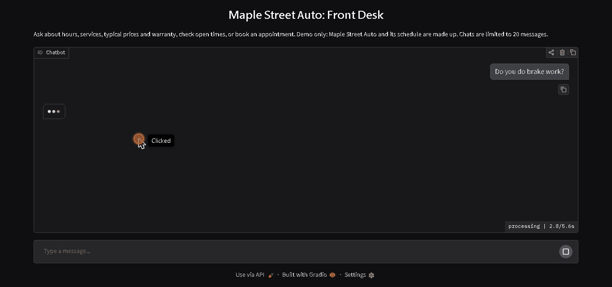

# Shop Front Desk

A tool-using AI agent for a **made-up** auto shop, Maple Street Auto. Everything (shop, prices, time slots, customers) is fake demo data.



*Demo, recorded locally: a shop question, "What's open Friday?" from the live sheet, then a booking that is read back and confirmed with "yes".*

It can:

1. **Answer shop questions** (hours, services, typical price ranges, warranty) with RAG over five short docs in `docs/`.
2. **Check open times** from a `Schedule` tab in a Google Sheet.
3. **Book an appointment**: it reads the details back, books only after an explicit "yes", re-checks the slot is still open, validates inputs with a Pydantic model, writes a row to an `Appointments` tab and marks the slot taken.

It never diagnoses a car or quotes a firm price: it gives typical ranges and says the final price follows an inspection. Chats are capped at 20 messages.

## How it works

```
Gradio (app.py)
  └─ LangGraph ReAct agent (agent.py, watsonx chat model)
       ├─ search_shop_docs   → Chroma (local embeddings) over docs/*.md   (ingest.py)
       ├─ get_open_slots     → Google Sheet "Schedule" tab                (tools.py)
       └─ book_appointment   → Pydantic validation → slot check → interrupt (readback)
                               → explicit yes? → re-check slot → write "Appointments" row
```

The confirmation is enforced in code, not left to the model: `book_appointment` pauses the graph with `interrupt()` and only a plain affirmative ("yes", "yes please") resumes it. Anything else, including "yes but make it 3pm", cancels. If a slot is taken, the tool asks the customer to pick another time instead of letting the model choose one.

## Run locally

```powershell
python -m venv .venv
.\.venv\Scripts\python -m pip install -r requirements.txt
copy .env.example .env      # then fill in your values
.\.venv\Scripts\python ingest.py     # builds the local Chroma index
.\.venv\Scripts\python app.py        # Gradio UI on http://localhost:7860
```

Or chat in the terminal with `python agent.py`.

### Configuration (`.env`, never committed)

| Variable | What |
|---|---|
| `WATSONX_APIKEY`, `WATSONX_URL`, `WATSONX_PROJECT_ID` | watsonx.ai credentials |
| `WATSONX_MODEL_ID` | tool-calling chat model (default `ibm/granite-4-h-small`) |
| `GOOGLE_SERVICE_ACCOUNT_FILE` | path to a service account JSON key (local) |
| `GOOGLE_SERVICE_ACCOUNT_JSON` | the key's JSON text (hosted, as a secret; wins over the file) |
| `SHEET_ID` | ID of the Google Sheet |

### Google Sheet setup

1. Create a Google Cloud project, enable the **Sheets** and **Drive** APIs, create a service account and a JSON key.
2. Create a sheet in your own Drive (service accounts can't own files) and share it with the service account's email as **Editor**.
3. Put the ID in `SHEET_ID`, then run `python seed_sheet.py`. It loads `data/schedule_seed.csv` into a `Schedule` tab (`Date, Day, Time, Status`) and creates an `Appointments` tab. Run it again any time to reset the demo.

## Tests

**Automated** (offline, no keys or sheet needed): booking validation (name, phone, date, time, service), time normalization, the strict "explicit yes" gate, and open-slot filtering.

```powershell
.\.venv\Scripts\python -m pip install -r requirements-dev.txt
.\.venv\Scripts\python -m pytest tests -q
```

**Grounding check** (calls the real model, needs `.env`): asks open-ended and trick questions several times each and flags invented services or a "yes, we do that" for something the shop doesn't offer.

```powershell
.\.venv\Scripts\python eval_grounding.py 3
```

It is a heuristic (a fixed list of services the shop does not offer, plus a decline pattern), so a pass means no known failure was seen, not that the model never invents.

**Manual** end-to-end cases and results (shop questions, bookings, "no" at confirm, an off-topic question, a taken slot) are in [tests.md](tests.md). They need the model and the sheet.

## Hosting

**Live demo:** https://shop-front-desk.onrender.com (Render free web service; fake data, may take up to a minute to wake after a quiet period).

It also runs locally (above). At the time of writing, Hugging Face Spaces required a paid PRO plan for Gradio apps, so it is hosted on **Render's free web service** instead (`render.yaml`).

### Deploy on Render (free)

1. Push this repo to GitHub (private is fine).
2. In Render: **New → Blueprint**, pick the repo. Render reads `render.yaml` (build: install + `python ingest.py`; start: `python app.py`).
3. When prompted, enter the five secrets: `WATSONX_APIKEY`, `WATSONX_URL`, `WATSONX_PROJECT_ID`, `SHEET_ID`, and `GOOGLE_SERVICE_ACCOUNT_JSON` (paste the whole key file's text).

Free-tier behavior: the service sleeps after 15 minutes without traffic and takes up to about a minute to wake, so the first chat after a nap is slow. The document index and embedding model are built at deploy time and kept in the project folder, so waking does not re-download them.

### Any other host

The app runs anywhere that runs Python:

- Set the variables in the table above as the host's secrets. Use `GOOGLE_SERVICE_ACCOUNT_JSON` (the key's JSON text) instead of a key file, and never commit keys.
- Start command: `python app.py`. The Chroma index is built automatically on first start.
- For a Hugging Face Space, add this block at the very top of this README:

  ```
  ---
  title: Maple Street Auto Front Desk
  sdk: gradio
  sdk_version: 6.32.0
  app_file: app.py
  ---
  ```

If hosted publicly, keep in mind that anyone could book fake slots on the shared sheet (reset it with `python seed_sheet.py`) and use your model quota. The 20-message cap is per chat session, not per person.
